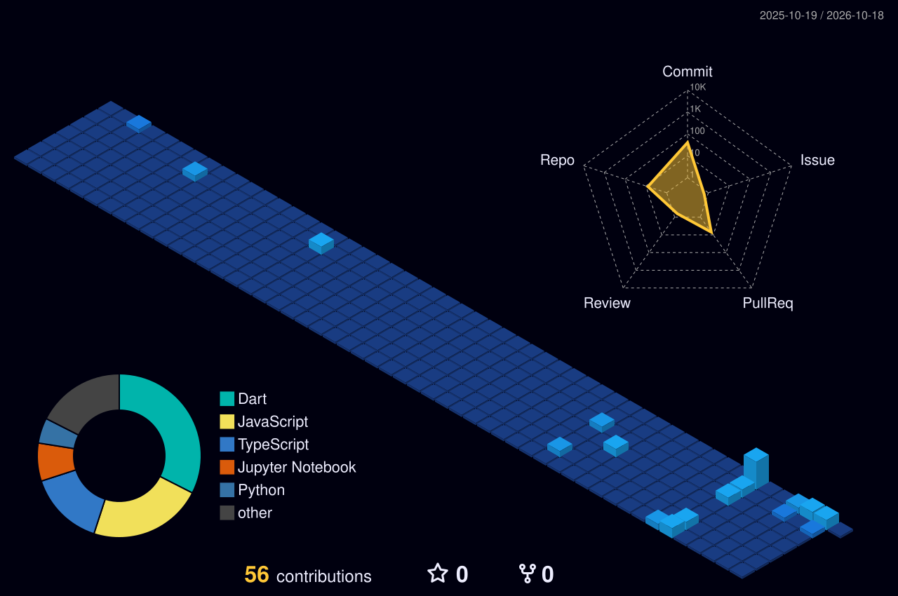

 

# Hi, I'm Noor Alam 👋

### Full-Stack Development × Machine Learning

*Building projects, solving problems, and exploring what's possible with technology.*

---

## 🚀 About Me

* 🎓 B.Tech Computer Science student.
* 🌐 Learning and building with **Full-Stack Development**.
* 🤖 Learning **Machine Learning** and exploring practical AI applications.
* 🧠 Currently exploring **Deep Learning and Generative AI**.
* 🔍 Curious about other fields of computer science and emerging technologies.
* 💻 Practicing DSA with Java and improving problem-solving skills.
* 🛠️ I enjoy learning by building, experimenting, and debugging real projects.

> My current focus is the intersection of **Full-Stack Development × Machine Learning**, while continuing to explore new areas of AI and software engineering.

## 🧰 Tech Stack

### Languages & Development

### Tools & Environment

### Areas I'm Exploring

*My toolkit is evolving as I learn and build new things.*

## 📊 GitHub Dashboard

 

## 📈 Contribution Activity

## 🧊 3D Contribution Graph

## 🧠 LeetCode

 

[Visit my LeetCode profile →](https://leetcode.com/u/Noor_Alam08/)

## 🏆 Featured Projects

A few repositories from my development journey:

* 🩺 **[Medical Chatbot](https://github.com/nooralam08/Medical_-Chatbot)** — A healthcare-focused chatbot project using AI and language-model tooling.
* 🤖 **[Medical Chatbot](https://github.com/nooralam08/medical-chatbot)** — Another repository from my medical chatbot project work.
* 💡 **[SIH-2026](https://github.com/nooralam08/SIH-2026)** — A Smart India Hackathon-related project repository.
* 🌱 **[Smriti Care](https://github.com/nooralam08/smriti-care)** — A project exploring a practical application through software development.
* 💻 **[New.Demo](https://github.com/nooralam08/New.Demo)** — Development experiments and practice.

*Explore the repositories for source code, implementation details, and project documentation.*

## 🎯 What's Next?

* 🌐 Build more complete full-stack applications.
* 🤖 Strengthen Machine Learning fundamentals through projects.
* 🧠 Explore Deep Learning and Generative AI.
* 💻 Keep practicing DSA and problem-solving.
* 🌍 Explore other areas of technology and contribute to open source.

---

### Thanks for visiting my profile! 👋

*Keep learning. Keep building. Keep exploring. 🚀*

